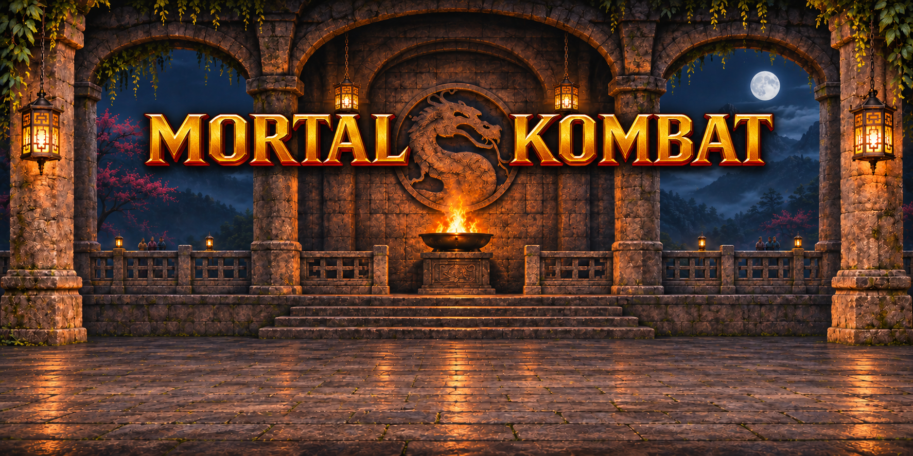
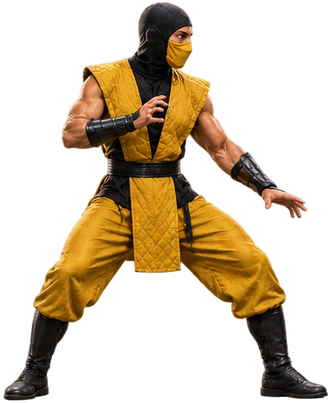
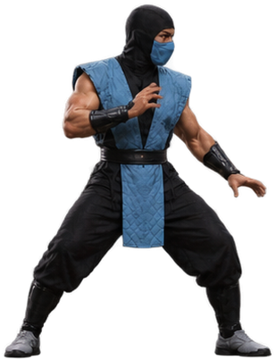
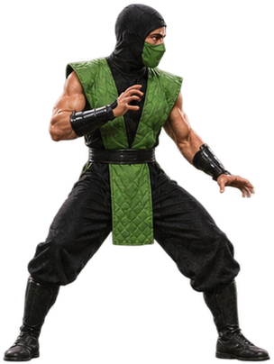
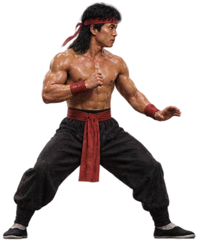
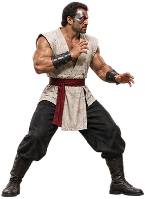
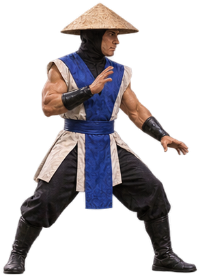
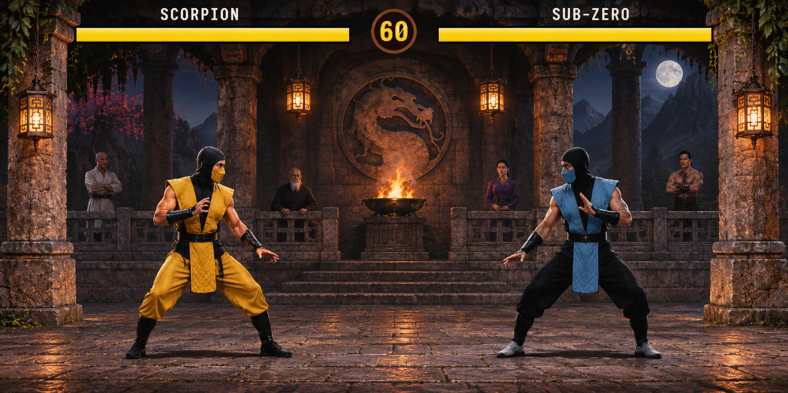

<div align="center">

# MORTAL KOMBAT

### Arcade tribute · Playable in your browser

**Enter the arena. Choose your fighter. Win the tournament.**

## [▶ Play the game online](https://nicolashedoire.github.io/mortal-kombat-1993-remake/)

[How to play](#getting-started) · [Controls](#controls) · [Fighters](#fighters) · [Special moves](#special-moves)



<sub>Artwork inspired by the arena used in the game.</sub>

</div>

---

## About the game

An unofficial tribute to the 1993 release of Mortal Kombat, built with **HTML, CSS and JavaScript** and a Canvas fighting engine. Play directly in a modern browser, with no installation or internet connection required.

- **Solo**: fight three computer-controlled opponents.
- **Local versus**: two players share the same keyboard.
- **Six fighters** with modernized sprites and distinct special moves.
- **Arcade atmosphere**: a redesigned arena, music and several sounds from the original game files.
- **Best of three rounds** to win each fight.

> Some moves, animations and mechanics are simplified compared with the original game.

## Getting started

**Play online:** [Launch Mortal Kombat in your browser](https://nicolashedoire.github.io/mortal-kombat-1993-remake/).

To play offline:

1. Download or clone this repository and keep its files together in the same folder.
2. Open **`index.html`** in a modern browser.
3. Choose **Jouer** (Play), review the controls and confirm.
4. Select **SOLO** or **VERSUS**, then choose your fighter.

The game works offline. Your first interaction with the page allows the browser to enable audio. If needed, click **Activer le son** (Enable sound) at the bottom of the screen. The game interface is currently in French.

## Controls

| Action | Player 1 | Player 2 · numeric keypad |
|:--|:--:|:--:|
| Move | ← / → | 4 / 6 |
| Jump / crouch | ↑ / ↓ | 8 / 2 |
| High punch / low punch | A / Z | 7 / 1 |
| High kick / low kick | E / C | 9 / 3 |
| Block | S | 5 |

The letter keys match the labels on **AZERTY** and **QWERTY** keyboards. Player 2 may need to enable **Num Lock**. Controls cannot yet be remapped.

| Key | Action |
|:--|:--|
| **Enter** | Confirm; return to the menu from pause |
| **Esc** | Pause or resume the fight |
| **H** | Show or close help |
| **M** | Toggle sound |
| **↓ + high punch** | Uppercut |
| **Jump + punch or kick** | Aerial attack |

## Fighters

<div align="center">

<table>
<tr>
<td align="center"><br><b>SCORPION</b></td>
<td align="center"><br><b>SUB-ZERO</b></td>
<td align="center"><br><b>REPTILE</b></td>
</tr>
<tr>
<td align="center"><br><b>LIU KANG</b></td>
<td align="center"><br><b>KANO</b></td>
<td align="center"><br><b>RAIDEN</b></td>
</tr>
</table>

<sub>Sprites used in the game; each fighter has several poses.</sub>

</div>

### Art direction



<sub>Concept artwork illustrating the visual direction; this is not a gameplay screenshot.</sub>

## Special moves

Directions are relative to the fighter: **forward** means toward your opponent; **back** means away from them. Enter the directions quickly, then press the indicated attack button.

| Fighter | Move | Input |
|:--|:--|:--|
| Scorpion | Spear | Back, back, low punch |
| Sub-Zero | Freeze ball | Down, forward, low punch |
| Reptile | Acid spit | Forward, forward, high punch |
| Liu Kang | Fireball | Forward, forward, high punch |
| Liu Kang | Flying kick | Forward, forward, high kick |
| Kano | Knife throw | Back, forward, high punch |
| Raiden | Lightning bolt | Down, forward, low punch |

After the final knockout, **FINISH HIM** uses a simplified mechanic: enter the winner's special move.

## Sound and music

The menu and fight music, the “Fight”, “Finish Him” and “Fatality” voice lines, and some impact sounds come from the original game files. Other effects are synthesized. Press **M** or use the on-screen sound button to mute or restore audio.

## Project structure

```text
index.html                 Game page and interface
game.js                    Fighting engine, scenes and controls
assets.js                  Embedded arcade sprites used as a fallback
audio-assets.js            Embedded sound effects
assets/arenas/             Arena background
assets/sprites-modern/     Poses for all six fighters
assets/audio/              Menu and fight music
tools/                     Asset preparation and extraction tools
```

The modern sprites use short animation cycles, and controls cannot yet be customized. The game is self-contained: the tools in `tools/` are not needed to play.

Some of these experimental tools expect the DOS files at `~/Desktop/Mortal_Kombat_1993/MK/MK1` and the project at `~/Desktop/Mortal Kombat Remake`. They require Python and Pillow; check their paths before use. In particular, `build_assets.py` regenerates assets and can overwrite restored sprites.

## Credits and resources

An unofficial tribute to **Mortal Kombat**. The music, some voices and some effects come from the original DOS game files supplied with the source project. The fallback arcade sprites were extracted from the same version; the modern images were generated with AI assistance. The uGRA/WrtNonZero extraction tools build on [ReWolf's work](https://github.com/rwfpl/rewolf-mortal-kombat-viewer) and [technical article](http://blog.rewolf.pl/blog/?p=1837). Characters, names, music and other original elements belong to their respective rights holders; no open-source license is granted for those assets here.

The `tools/ugra_extract.py` extractor port specifies LGPL version 3 or later; the [LGPL 3.0](LICENSES/LGPL-3.0.txt) and the [GPL 3.0](LICENSES/GPL-3.0.txt), to which it refers, are included. This notice does not apply to the original game assets.

For more detailed instructions, see the [game guide](GAME_GUIDE.md).
