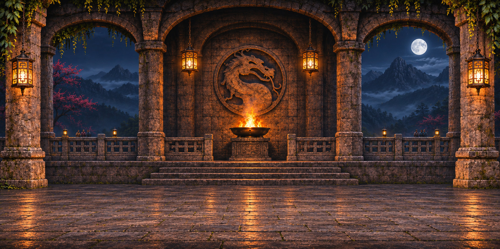

<div align="center">

# MORTAL KOMBAT

### Remake amateur · Hommage à l'arcade · Jouable dans le navigateur

**Entre dans l'arène. Choisis ton combattant. Remporte le tournoi.**

[Comment jouer](#-lancer-le-jeu) · [Commandes](#-commandes) · [Combattants](#-les-combattants) · [Coups spéciaux](#-coups-spéciaux)



<sub>Le décor de l'arène présent dans le jeu.</sub>

</div>

---

## Le jeu en quelques mots

Un hommage non officiel au Mortal Kombat de 1993, réécrit en **HTML, CSS et JavaScript** avec un moteur de combat Canvas. Le jeu fonctionne directement dans un navigateur récent, sans installation ni connexion Internet.

- **Solo** : affronte trois adversaires contrôlés par l'ordinateur.
- **Versus local** : deux joueurs s'affrontent sur le même clavier.
- **Six combattants** aux sprites modernisés et coups spéciaux distincts.
- **Ambiance arcade** : arène retravaillée, musiques et plusieurs sons issus des fichiers d'origine.
- **Deux rounds gagnants** pour remporter un combat.

> Cette adaptation est un projet amateur : certains mouvements, animations et mécanismes sont simplifiés par rapport au jeu original.

## ▶ Lancer le jeu

1. Télécharge ou clone ce dépôt, puis conserve tous ses fichiers dans le même dossier.
2. Ouvre **`index.html`** dans un navigateur récent.
3. Choisis **Jouer**, consulte la fenêtre des commandes, puis valide.
4. Sélectionne **SOLO** ou **VERSUS**, puis ton combattant.

Le jeu fonctionne hors ligne. La première interaction avec la page permet au navigateur d'activer le son ; si nécessaire, utilise le bouton **Activer le son** en bas de l'écran.

## 🎮 Commandes

| Action | Joueur 1 | Joueur 2 · pavé numérique |
|:--|:--:|:--:|
| Se déplacer | ← / → | 4 / 6 |
| Sauter / s'accroupir | ↑ / ↓ | 8 / 2 |
| Poing haut / poing bas | A / Z | 7 / 1 |
| Pied haut / pied bas | E / C | 9 / 3 |
| Bloquer | S | 5 |

Les lettres correspondent à celles du clavier, en **AZERTY** comme en **QWERTY**. Pour le joueur 2, active **Verr. Num** si nécessaire. Les touches ne sont pas encore personnalisables.

| Touche | Action |
|:--|:--|
| **Entrée** | Valider ; depuis la pause, revenir au menu |
| **Échap** | Mettre le combat en pause ou reprendre |
| **H** | Afficher ou fermer l'aide |
| **M** | Activer ou couper le son |
| **↓ + poing haut** | Uppercut |
| **Saut + poing ou pied** | Coup aérien |

## 🥋 Les combattants

<div align="center">

<table>
<tr>
<td align="center"><br><b>SCORPION</b></td>
<td align="center"><br><b>SUB-ZERO</b></td>
<td align="center"><br><b>REPTILE</b></td>
</tr>
<tr>
<td align="center"><br><b>LIU KANG</b></td>
<td align="center"><br><b>KANO</b></td>
<td align="center"><br><b>RAIDEN</b></td>
</tr>
</table>

<sub>Sprites utilisés dans le jeu ; chaque combattant possède plusieurs poses.</sub>

</div>

### Direction artistique


<sub>Maquette de conception : illustration de la direction visuelle, pas une capture du jeu.</sub>

## ⚡ Coups spéciaux

Les directions sont relatives au combattant : **avant** signifie vers l'adversaire ; **arrière** signifie s'en éloigner. Saisis les directions rapidement, puis appuie sur le coup indiqué.

| Combattant | Coup | Commande |
|:--|:--|:--|
| Scorpion | Harpon | Arrière, arrière, poing bas |
| Sub-Zero | Boule de glace | Bas, avant, poing bas |
| Reptile | Crachat acide | Avant, avant, poing haut |
| Liu Kang | Boule de feu | Avant, avant, poing haut |
| Liu Kang | Pied volant | Avant, avant, pied haut |
| Kano | Couteau | Arrière, avant, poing haut |
| Raiden | Éclair | Bas, avant, poing bas |

Après le dernier K.O., le système **FINISH HIM** est une adaptation simplifiée : il suffit de saisir le coup spécial du vainqueur.

## 🔊 Son et musique

Les musiques du menu et des combats, les voix « Fight », « Finish Him », « Fatality » et certains impacts proviennent des fichiers du jeu d'origine. Les autres effets sont synthétisés. Utilise **M** ou le bouton **Son** pour les couper ou les réactiver.

## 📁 Organisation du projet

```text
index.html                 Page et interface du jeu
game.js                    Moteur de combat, scènes et commandes
assets.js                  Sprites arcade intégrés en repli
audio-assets.js            Sons intégrés
assets/arenas/             Décor de l'arène
assets/sprites-modern/     Poses des six combattants
assets/audio/              Musiques du menu et du combat
tools/                     Outils de préparation et d'extraction
```

Les sprites modernes utilisent des cycles courts, et les touches ne sont pas encore configurables. Le projet est autonome pour jouer : les outils de `tools/` ne sont pas nécessaires au lancement.

Ces outils expérimentaux supposent pour certains que les fichiers DOS se trouvent dans `~/Desktop/Mortal_Kombat_1993/MK/MK1` et que le projet est dans `~/Desktop/Mortal Kombat Remake`. Ils nécessitent Python et Pillow ; vérifie leurs chemins avant utilisation. En particulier, `build_assets.py` régénère des ressources et peut remplacer les sprites restaurés.

## Crédits et ressources

Hommage amateur et non officiel à **Mortal Kombat**. Les musiques, certaines voix et certains effets proviennent des fichiers de la version DOS originale fournis avec le projet de départ. Les sprites arcade de repli sont extraits de cette même version ; les images modernes sont des créations générées avec assistance IA. Les outils d'extraction uGRA/WrtNonZero s'appuient sur les travaux de [ReWolf](https://github.com/rwfpl/rewolf-mortal-kombat-viewer) et son [article technique](http://blog.rewolf.pl/blog/?p=1837). Les personnages, noms, musiques et autres éléments originaux appartiennent à leurs ayants droit respectifs ; aucune licence libre ne leur est attribuée ici.

Le port de l'extracteur `tools/ugra_extract.py` indique une licence LGPL version 3 ou ultérieure ; les textes [LGPL 3.0](LICENSES/LGPL-3.0.txt) et [GPL 3.0](LICENSES/GPL-3.0.txt), à laquelle elle renvoie, sont inclus. Cette mention ne s'applique pas aux ressources du jeu d'origine.

Pour les instructions détaillées en français, consulte aussi [LISEZ-MOI.md](LISEZ-MOI.md).
